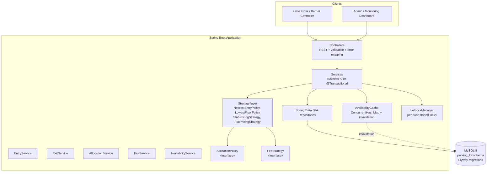
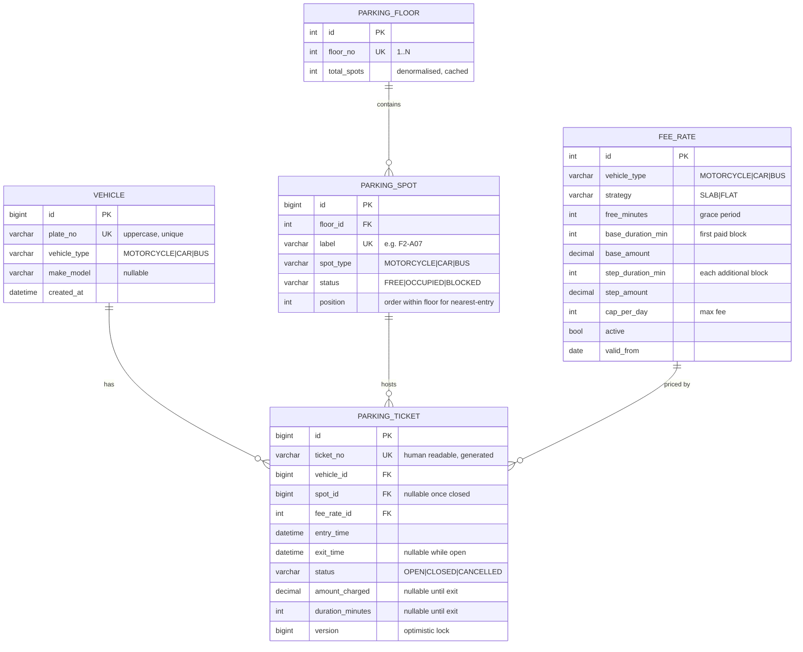
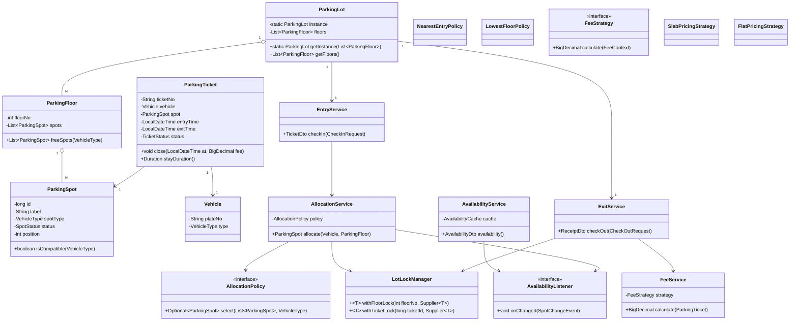
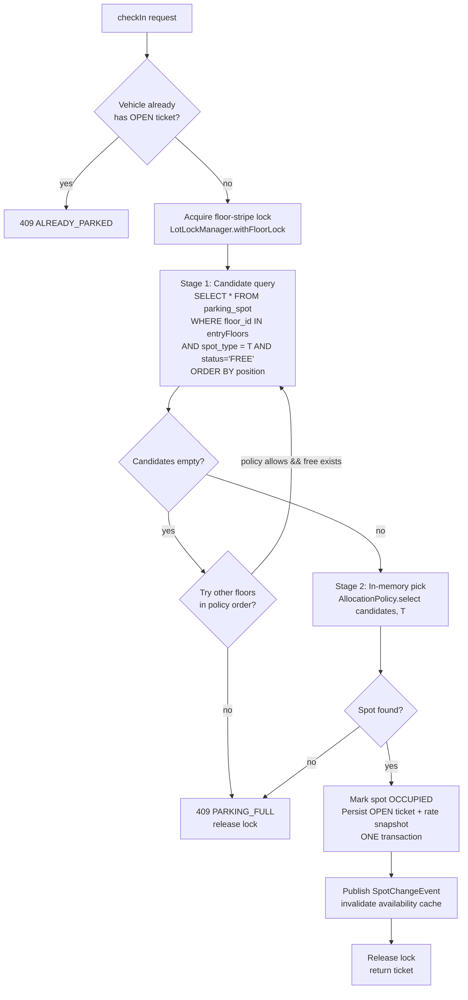
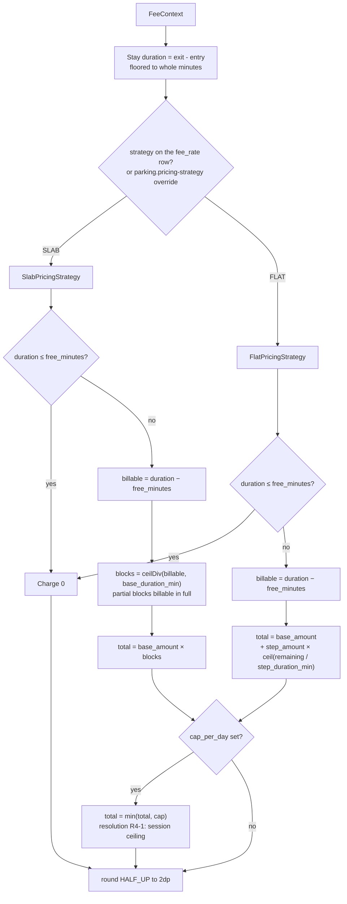
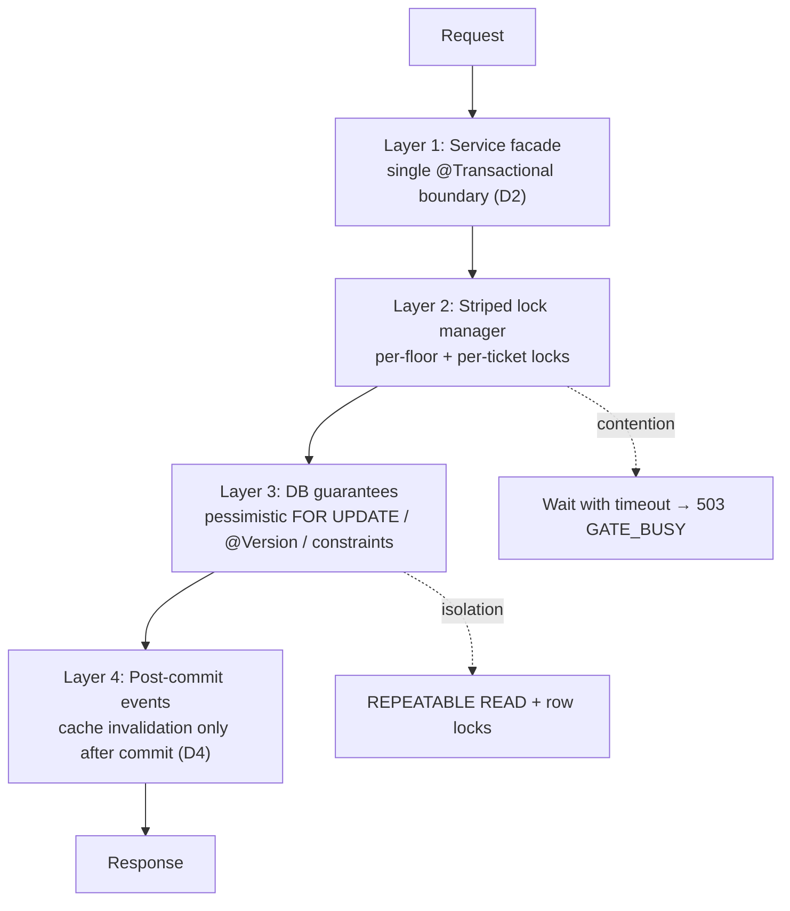
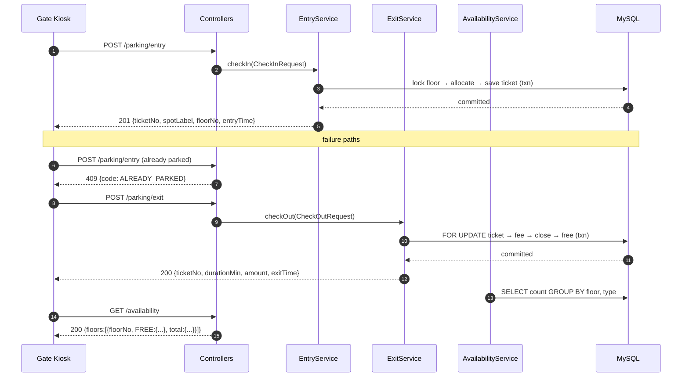

# Architecture — Smart Parking Lot System (LLD)

> Low-level design for a smart parking-lot backend.
> Stack: **Java 8 · Spring Boot 2.7.x · MySQL 8 · Maven** · Diagrams: **Mermaid** · Code: key snippets only.
> Companion document: [`planning.md`](planning.md)

---

## Table of contents

1. [Overview, scope, goals & assumptions](#1-overview-scope-goals--assumptions)
2. [High-level layered architecture](#2-high-level-layered-architecture)
3. [Data model / DB schema](#3-data-model--db-schema)
4. [Core classes & design patterns](#4-core-classes--design-patterns)
5. [Spot allocation algorithm](#5-spot-allocation-algorithm)
6. [Fee calculation logic](#6-fee-calculation-logic)
7. [Concurrency design](#7-concurrency-design)
8. [API / interface contracts](#8-api--interface-contracts)
9. [Extensibility & non-functional notes](#9-extensibility--non-functional-notes)

---

## 1. Overview, scope, goals & assumptions

### 📌 Objective

Low-level design for a smart parking-lot backend that manages vehicle entry/exit across a multi-floor lot,
automatically assigns spots by vehicle type, tracks stay duration, and computes fees at exit — safe under
concurrent gate activity.

### 🎯 Goals

| ID | Goal |
|----|------|
| G1 | Deterministic, size-correct spot allocation (motorcycle / car / bus) |
| G2 | Accurate entry/exit timestamps and one open ticket per vehicle |
| G3 | Fee calculation driven by duration + vehicle type, configurable rates |
| G4 | Real-time availability visible per floor and per spot type |
| G5 | Correct under concurrency: no double-booking of a spot, no lost updates |
| G6 | Extensible: new vehicle types, pricing rules, or allocation policies without touching core code |

### 🚧 Scope

| In scope | Out of scope (assumed) |
|---|---|
| Spot allocation, check-in/check-out | Physical sensors / gate hardware integration |
| Fee calculation & pricing rules | Payment gateway / card processing |
| Real-time availability | Advance reservations & subscriptions |
| Persistence (MySQL), concurrency safety | Admin UI / analytics dashboards |
| REST API contracts | Multi-lot / multi-site federation |

### 🔑 Assumptions

- **A1** Spot types: `MOTORCYCLE`, `CAR`, `BUS`. A vehicle is assigned a spot of its own type; larger spots
  never host smaller vehicles (keeps allocation deterministic — flagged as a tunable policy).
- **A2** A `BUS` spot is modeled as a dedicated large spot (alternative: 3 consecutive CAR spots — see §9).
- **A3** One vehicle → at most one open ticket; re-entry while parked is rejected.
- **A4** Timestamps come from a single injectable `Clock` (testable, immune to gate-server clock skew).
- **A5** Fee is computed and paid at exit; the ticket is then closed and the spot freed.
- **A6** Single parking lot instance (singleton) for v1; multi-lot is an extension.
- **A7** Availability = derived from spot state (`FREE` / `OCCUPIED`), not from counters, to avoid drift.

### 🧰 Tech stack

| Concern | Choice |
|---|---|
| Language / runtime | Java 8 (source & target 1.8) |
| Framework | Spring Boot **2.7.x** (last line with Java 8 support) — Spring Web, Spring Data JPA, Validation |
| Database | MySQL 8 |
| Migrations | Flyway (`V1__init.sql`, `V2__seed_rates.sql`, `V3__seed_lot.sql`) |
| Build | Maven |
| Tests | JUnit + AssertJ, `@DataJpaTest` with H2, Testcontainers MySQL for concurrency |
| Optional | Lombok (design works without it) |

---

## 2. High-level layered architecture

### 🏗️ Layered view



### 📦 Layer responsibilities

| Layer | Package | Responsibility | Knows about |
|---|---|---|---|
| **Controller** | `...web` | HTTP contract, request validation, DTO ↔ domain mapping, error body (`409` conflict, `404` unknown plate, `409` already-parked) | Services only |
| **Service** | `...service` | Use cases: `checkIn`, `checkOut`, `getAvailability`. Owns `@Transactional` boundaries, lock acquisition, ticket lifecycle | Strategies, repos, cache |
| **Strategy** | `...strategy` | Pure, side-effect-free algorithms: which spot? how much fee? | Domain objects only |
| **Domain** | `...model` | Entities & enums: `Vehicle`, `ParkingFloor`, `ParkingSpot`, `ParkingTicket`, `FeeRate`, `VehicleType`, `SpotStatus` | Nothing (no Spring) |
| **Persistence** | `...repository` | JPA repositories, custom lock/availability queries | Domain |
| **Infrastructure** | `...config`, `...cache`, `...lock` | `Clock` bean, lock striping, availability cache, Flyway | Domain/Service |

### 🔁 Key flows (detailed in Steps 5 & 7)

**Check-in:** `POST /api/v1/parking/entry` → validate no open ticket → acquire floor-stripe lock →
find free spot (strategy) → occupy spot + create ticket in **one transaction** → invalidate cache → return ticket.

**Check-out:** `POST /api/v1/parking/exit` → lock ticket row (pessimistic) → compute fee (strategy) →
close ticket + free spot in **one transaction** → invalidate cache → return receipt.

### 🧭 Design decisions in this layer

- **D1 — Strategies are stateless beans:** allocation and pricing are swappable via config
  (`parking.allocation-policy=nearest-entry`) without touching services.
- **D2 — Transaction boundary lives in the Service**, not the Controller or Repository — so
  lock → allocate → persist is atomic.
- **D3 — Domain model has zero Spring imports**, so pricing/allocation logic is unit-testable in isolation.
- **D4 — Cache is an optimisation, DB is the source of truth** (falls back to DB on miss/invalidation).

---

## 3. Data model / DB schema

### 🗺️ ER diagram



### 📄 DDL (Flyway `V1__init.sql`)

```sql
CREATE TABLE vehicle (
  id           BIGINT AUTO_INCREMENT PRIMARY KEY,
  plate_no     VARCHAR(20)  NOT NULL,
  vehicle_type VARCHAR(12)  NOT NULL,
  make_model   VARCHAR(60)  NULL,
  created_at   DATETIME     NOT NULL DEFAULT CURRENT_TIMESTAMP,
  UNIQUE KEY uk_vehicle_plate (plate_no)
);

CREATE TABLE parking_floor (
  id       INT AUTO_INCREMENT PRIMARY KEY,
  floor_no INT NOT NULL,
  UNIQUE KEY uk_floor_no (floor_no)
);

CREATE TABLE parking_spot (
  id        BIGINT AUTO_INCREMENT PRIMARY KEY,
  floor_id  INT NOT NULL,
  label     VARCHAR(16) NOT NULL,
  spot_type VARCHAR(12) NOT NULL,
  status    VARCHAR(10) NOT NULL DEFAULT 'FREE',
  position  INT NOT NULL,
  CONSTRAINT fk_spot_floor FOREIGN KEY (floor_id) REFERENCES parking_floor(id),
  UNIQUE KEY uk_spot_label (label),
  KEY idx_spot_lookup (floor_id, spot_type, status, position)
);

CREATE TABLE fee_rate (
  id                INT AUTO_INCREMENT PRIMARY KEY,
  vehicle_type      VARCHAR(12) NOT NULL,
  strategy          VARCHAR(10) NOT NULL DEFAULT 'SLAB',
  free_minutes      INT NOT NULL DEFAULT 0,
  base_duration_min INT NOT NULL,
  base_amount       DECIMAL(10,2) NOT NULL,
  step_duration_min INT NULL,
  step_amount       DECIMAL(10,2) NULL,
  cap_per_day       DECIMAL(10,2) NULL,
  active            TINYINT(1) NOT NULL DEFAULT 1,
  valid_from        DATE NOT NULL,
  KEY idx_rate_lookup (vehicle_type, active, valid_from)
);

CREATE TABLE parking_ticket (
  id               BIGINT AUTO_INCREMENT PRIMARY KEY,
  ticket_no        VARCHAR(24) NOT NULL,
  vehicle_id       BIGINT NOT NULL,
  spot_id          BIGINT NULL,
  fee_rate_id      INT NULL,
  entry_time       DATETIME NOT NULL,
  exit_time        DATETIME NULL,
  status           VARCHAR(10) NOT NULL DEFAULT 'OPEN',
  amount_charged   DECIMAL(10,2) NULL,
  duration_minutes INT NULL,
  version          BIGINT NOT NULL DEFAULT 0,
  CONSTRAINT fk_tkt_vehicle FOREIGN KEY (vehicle_id) REFERENCES vehicle(id),
  CONSTRAINT fk_tkt_spot    FOREIGN KEY (spot_id)    REFERENCES parking_spot(id),
  CONSTRAINT fk_tkt_rate    FOREIGN KEY (fee_rate_id) REFERENCES fee_rate(id),
  UNIQUE KEY uk_ticket_no (ticket_no),
  KEY idx_tkt_open (status, vehicle_id),
  KEY idx_tkt_spot_open (spot_id, status)
);
```

### 🧠 Mapping & modelling notes

- **N1 — Ticket status is the ticket lifecycle.** `spot_id` is kept after close for history/audit, but the
  "one open ticket per spot" rule is enforced by application-level locking (Step 7) rather than a partial
  unique index (MySQL lacks native partial indexes) — a deliberate trade-off.
- **N2 — `position`** on `parking_spot` gives a total order per floor so "nearest to the entrance" is a
  simple `ORDER BY position` — no geometry needed.
- **N3 — `fee_rate` is data, not code**: changing prices = `UPDATE`, no redeploy. `valid_from` supports dated
  rate cards; the service picks the latest active row at check-in.
- **N4 — Snapshot the rate at check-in** (`parking_ticket.fee_rate_id`) so a mid-stay price change cannot
  alter what the customer owes.
- **N5 — Availability is derived** (`COUNT(*) WHERE status='FREE'`) — no counter column that could drift
  (per Assumption A7).
- **N6 — Soft-delete not needed** for spots; `status='BLOCKED'` covers maintenance.
- **N7 — JPA entities** use `@Version` on `ParkingTicket` for optimistic locking; `ParkingSpot.status` uses
  pessimistic locking at allocation time.

---

## 4. Core classes & design patterns

### 🧬 Class diagram



### 🎯 Pattern → responsibility map

| # | Pattern | Where | Why (and when it earns its keep) |
|---|---|---|---|
| P1 | **Strategy** | `AllocationPolicy`, `FeeStrategy` | Swap allocation rules (`nearest-entry` vs `lowest-floor`) and pricing (`slab` vs `flat`) via config, no service change. Core of G6. |
| P2 | **Singleton** | `ParkingLot` | One lot instance per process; the Spring `@Bean` scope delivers this — *the GoF static singleton is deliberately avoided* (untestable). Explicit design decision. |
| P3 | **Factory** | `TicketFactory` | Centralises ticket-number generation + rate snapshot so no service hand-rolls it. |
| P4 | **Observer** | `AvailabilityListener` ← `AvailabilityCache`, WebSocket notifier, metrics | Allocation/exit publish `SpotChangeEvent`; cache invalidation + future real-time push are decoupled from the transactional path. |
| P5 | **Facade** | `EntryService` / `ExitService` | Hide repos, strategies, locks, cache behind one use-case call each. |
| P6 | **Builder** | `FeeContext` (entry, exit, type, rate) | Fee inputs grow over time; builder avoids a 6-arg constructor and keeps `FeeStrategy.calculate(FeeContext)` stable. |
| P7 | **DTO + Mapper** | `CheckInRequest`, `TicketDto`, `ReceiptDto` | Entities never leak to HTTP layer (D3), keeping domain Spring-free. |

### 🔑 Key snippet — the two strategy seams

```java
public interface AllocationPolicy {
    Optional<ParkingSpot> select(List<ParkingSpot> freeSpots, VehicleType type);
}

@Component("nearestEntry")
public class NearestEntryPolicy implements AllocationPolicy {
    @Override public Optional<ParkingSpot> select(List<ParkingSpot> free, VehicleType type) {
        return free.stream()
            .filter(s -> s.isCompatible(type))                     // exact type match (A1)
            .min(Comparator.comparingInt(ParkingSpot::getPosition)); // N2
    }
}

public interface FeeStrategy {
    BigDecimal calculate(FeeContext ctx);
}
```

Wiring (config-driven selection):

```yaml
parking:
  allocation-policy: nearest-entry   # or: lowest-floor
  pricing-strategy: slab             # or: flat
```

```java
public AllocationService(FeeStrategy fee, LotLockManager locks,
        AvailabilityListener listener,
        @Value("${parking.allocation-policy}") String policyName) { ... }
```

### ⚖️ Patterns consciously *not* used

- **Abstract Factory / heavy Factory hierarchy** — only two strategy families; a hierarchy would be ceremony.
- **Static GoF Singleton** — replaced by Spring-managed bean (testability).
- **Decorator for pricing** — slabs compose as data in `fee_rate`, not as object wrapping.

---

## 5. Spot allocation algorithm

### 🎯 Problem

Given a vehicle of type `T` entering floor set `F`, choose exactly one spot that is `FREE`, type-compatible,
and preferred by the active policy — atomically, while other gates may be allocating at the same time.

### 📥 Inputs & outputs

- **In:** `VehicleType T`, entry floor (default: floor 1 / configured entry floors), active `AllocationPolicy`
- **Out:** `Optional<ParkingSpot>` — empty ⇒ lot full for that type → reject check-in with `409 PARKING_FULL`

### 🔍 Two-stage selection



### 🧮 The algorithm

```java
// Stage 1 — DB (uses idx_spot_lookup: floor_id, spot_type, status, position)
List<ParkingSpot> free = spotRepo.findFreeByFloorAndType(floorIds, type);

// Stage 2 — pure selection (unit-tested, no Spring)
Optional<ParkingSpot> chosen = policy.select(free, type);
```

```java
@Transactional
public TicketDto checkIn(CheckInRequest req) {
    Vehicle v = vehicleRepo.findByPlate(req.getPlate())
            .orElseGet(() -> vehicleRepo.save(new Vehicle(req.getPlate(), req.getType())));

    if (ticketRepo.existsOpenTicketForVehicle(v.getId()))
        throw new ConflictException("ALREADY_PARKED");

    return locks.withFloorLock(req.getEntryFloor(), () -> {
        ParkingSpot spot = allocateOrThrow(v, req.getEntryFloor());   // Stage 1+2
        ParkingTicket t   = ticketFactory.open(v, spot, rateSnapshot(v.getType()), clock.now());
        spot.setStatus(SpotStatus.OCCUPIED);
        spotRepo.save(spot);
        ticketRepo.save(t);
        listener.publish(SpotChangeEvent.occupied(spot));             // after-commit
        return TicketDto.from(t);
    });
}
```

### 🏷️ Policy variants (both shipped, config-selectable)

| Policy | Order | Best for | Complexity |
|---|---|---|---|
| `nearest-entry` | `ORDER BY position` on the entry floor, first compatible | Minimising walking distance | O(k) over candidates |
| `lowest-floor` | Scan floors ascending, first compatible spot | Keeping upper floors free for large vehicles | O(F) queries worst case, stops early |

Both are **O(k)** in memory where k = free candidates of that type; the DB index makes Stage 1 a range scan,
not a table scan. The candidate list can be capped (`LIMIT 50`) since the policy only needs a prefix.

### 🚌 Vehicle-type rules (A1 / A2)

| Vehicle | Matches | Fallback |
|---|---|---|
| `MOTORCYCLE` | `MOTORCYCLE` spots | optionally `CAR` spots (config `parking.allow-motorcycle-on-car: false`, default off ⇒ deterministic) |
| `CAR` | `CAR` spots | none (a CAR never takes a BUS spot even if empty — keeps BUS capacity reserved) |
| `BUS` | `BUS` spots | none in v1; **extension:** compose 3 adjacent `CAR` spots — see §9 |

### ⚡ Concurrency safety (design-level; mechanics in §7)

1. **Striped lock per floor** serialises *allocation* on the same floor — the spot can't be handed to two vehicles.
2. **Status transition is inside the transaction** — a failure rolls back both spot and ticket, so no
   "occupied spot without ticket".
3. **`afterCommit` event publication** — cache invalidation never sees an uncommitted change.
4. Direct API calls (e.g. admin marking a spot `BLOCKED`) use `SELECT ... FOR UPDATE` on the spot row as a
   second line of defence.

### 🧪 Edge cases handled

| Case | Behaviour |
|---|---|
| Lot full for that type | `409 PARKING_FULL`, no ticket row created |
| Vehicle already parked | `409 ALREADY_PARKED` (A3) |
| Duplicate plate, different case (`ab12` vs `AB12`) | Plate normalised to uppercase before lookup (`uk_vehicle_plate`) |
| Spot freed but cache stale | Cache miss ⇒ re-read DB (D4); event invalidates on commit |
| Ticket creation fails mid-way | Whole transaction rolls back → spot still `FREE` |
| Admin blocked last free spot | Blocked spots filtered by `status='FREE'` predicate — never selected |
| All floors full but type mismatched (e.g. BUS) | `409 PARKING_FULL_FOR_TYPE` (distinct message aids ops) |

### ✅ Complexity summary

- **Time:** O(k) selection, k = free candidates (index-bounded)
- **Space:** O(k) transient per allocation; no global in-memory spot index to keep coherent ⇒
  **DB stays the source of truth** (consistent with D4 / A7)

---

## 6. Fee calculation logic

### 📐 Inputs

`FeeContext` = { `vehicleType`, `entryTime`, `exitTime`, `FeeRate` snapshot taken at check-in (N4) }

**Rule:** rates are frozen at entry — a price change mid-stay never affects an open ticket.

### 🧮 The two strategies



> **See "Implementation resolutions" below** — the SLAB branch is pure block math
> (`D3 → D4 → D9`); the base-then-steps arithmetic belongs to FLAT. `SlabPricingStrategy` and
> `FlatPricingStrategy` extend a shared `AbstractPricingStrategy` that owns grace, cap and rounding.

### 💻 Key snippet

```java
public abstract class AbstractPricingStrategy implements FeeStrategy {
    @Override
    public final BigDecimal calculate(FeeContext ctx) {
        FeeRate r = ctx.getRate();                       // snapshot from ticket (N4)
        long stayMin = ctx.getStayMinutes();             // exit - entry, floored to minutes

        if (stayMin <= r.getFreeMinutes()) return ZERO;  // R3: grace compares the TOTAL stay

        BigDecimal total = compute(r, stayMin);          // strategy-specific (SLAB / FLAT)

        BigDecimal cap = r.getCapPerDay();               // R4-1: session ceiling
        if (cap != null && total.compareTo(cap) > 0) total = cap;

        return total.setScale(2, RoundingMode.HALF_UP);  // R2: once, at the very end
    }

    protected abstract BigDecimal compute(FeeRate r, long stayMinutes);

    protected static long ceilDiv(long a, long b) { return (a + b - 1) / b; }  // round up
}

public class SlabPricingStrategy extends AbstractPricingStrategy {
    @Override
    protected BigDecimal compute(FeeRate r, long stayMinutes) {
        long billable = Math.max(0, stayMinutes - r.getFreeMinutes());
        long blocks = ceilDiv(billable, r.getBaseDurationMin()); // partial blocks billable in full
        return r.getBaseAmount().multiply(BigDecimal.valueOf(blocks));
    }
}

public class FlatPricingStrategy extends AbstractPricingStrategy {
    @Override
    protected BigDecimal compute(FeeRate r, long stayMinutes) {
        long billable  = Math.max(0, stayMinutes - r.getFreeMinutes());
        long remaining = billable - r.getBaseDurationMin();
        if (remaining <= 0) return r.getBaseAmount();
        long steps = ceilDiv(remaining, r.getStepDurationMin());   // fails loudly if unset
        return r.getBaseAmount().add(r.getStepAmount().multiply(BigDecimal.valueOf(steps)));
    }
}
```

### 📊 Worked examples (default rate card → seed data `V2__seed_rates.sql`)

| Vehicle | strategy | free | base block | base ₹ | step | cap/day |
|---|---|---|---|---|---|---|
| MOTORCYCLE | `SLAB` | 15 min | 1 h | ₹10 | ₹5 / 30 min *(reserved)* | ₹60 |
| CAR | `SLAB` | 30 min | 2 h | ₹40 | ₹20 / hour *(reserved)* | ₹200 |
| BUS | `FLAT` | 0 min | 1 h | ₹80 | ₹40 / hour | ₹500 |

| Stay | Vehicle | Calculation | Fee |
|---|---|---|---|
| 10 min | CAR | ≤ 30 min grace | **₹0** |
| 45 min | CAR | billable 15 → ceil(15/120) = 1 block | **₹40** |
| 3 h | CAR | billable 150 → ceil(150/120) = 2 → 2×40 | **₹80** |
| 5 h | CAR | billable 270 → ceil(270/120) = 3 → 3×40 | **₹120** |
| 25 h | CAR | billable 1470 → 13 blocks = ₹520 → capped | **₹200** |
| 20 min | MOTORCYCLE | > 15 min grace → 1 block | **₹10** |
| 90 min | BUS | 1 block + ceil(30/60) = 1 step ⇒ 80+40 | **₹120** |

*(Exact block arithmetic is locked by unit tests — these tables become the test fixtures.)*

#### ✅ Implementation resolutions

Three inconsistencies between the flow-chart, the code snippet and the table above were found while
building the code. The **worked-example table is authoritative** (it is what acceptance TC-3 asserts),
so the design was tightened as follows — all 7 rows now reproduce exactly in
`PricingStrategiesTest`:

| # | Issue | Resolution |
|---|---|---|
| **SLAB-1** | The chart's `D4 → D5 → D6 → D7` branch ("base + steps") gives CAR 3 h = ₹60 and 5 h = ₹100, but the table says ₹80 / ₹120. | **SLAB = pure block model**: `total = base_amount × ceil(billable / base_duration_min)` (the code snippet's arithmetic). It matches every MOTORCYCLE and CAR row. The chart branch `D4→D5→D6→D7` is the FLAT path; for SLAB the flow is `D4 → D9`. |
| **FLAT-1** | BUS 90 min = ₹120 can only come from "one base block + one step" (`80 + 40`), not from `ceil(90/60) × 80 = ₹160`. | **BUS is seeded with `strategy = 'FLAT'`** in `V2__seed_rates.sql`; MOTORCYCLE and CAR stay `SLAB`. FLAT = `base_amount + step_amount × ceil((billable − base_duration_min) / step_duration_min)`. |
| **R4-1** | Rule R4 says `effectiveCap = cap × ceil(totalMinutes / 1440)`, which prices the 25 h example at **₹400**, while the table says **₹200**. | `cap_per_day` is applied as a **session ceiling**: `total = min(total, cap)`. This reproduces the table. Scaling the ceiling with elapsed days (`cap × ceil(billable / 1440)`) is recorded as a documented extension in §9, not implemented in v1. |

Two smaller notes:

- **Step columns are strategy-specific.** SLAB never reads `step_duration_min` / `step_amount`
  (they are reserved for a future tiered-slab extension); FLAT requires them and fails loudly
  (`IllegalStateException`) if a FLAT card omits them — a misconfigured card must never silently
  under-charge.
- **Timestamp resolution is 1 second.** The schema column is `DATETIME`, so every timestamp is
  `truncatedTo(SECONDS)` at the service boundary. Sub-second values would be lost on reload and make
  a stored `duration_minutes` drift by one minute (this bug was caught by `ExitFlowIntegrationTest`).

### ⏱️ Time, rounding & edge rules

- **R1 — Clock:** single injectable `Clock` (A4); duration = `ChronoUnit.MINUTES.between(entry, exit)`,
  **floored**, then block math **rounds up** (never both ways).
- **R2 — Rounding:** `HALF_UP` to 2 decimals, only at the final step.
- **R3 — Grace:** `free_minutes` compares against *total* stay, not billable stay.
- **R4 — Cross-midnight / multi-day (amended, see resolution R4-1):** `cap_per_day` is a
  **session ceiling**: `total = min(total, cap)`. The multi-day scaling `cap × ceil(billable / 1440)`
  is a documented extension (§9) and is *not* applied in v1 — otherwise the 25 h example below would
  bill ₹400 instead of the specified ₹200.
- **R5 — Clock skew:** `exitTime < entryTime` ⇒ validation error `400 INVALID_EXIT_TIME`, never a negative fee.
- **R6 — Missing rate:** no active `FeeRate` for the type ⇒ fail fast at **check-in**
  (`503 RATE_NOT_CONFIGURED`), not at exit — avoids trapping a vehicle with an unpriceable ticket.
- **R7 — Rounding currency:** `BigDecimal` everywhere; **never `double`** for money.
- **R8 — Config change mid-stay:** ignored (rate snapshot, N4). Admin can still override a final fee via
  `PUT /tickets/{no}/adjust` (audited) — extension noted in §9.

### 🧪 Where it's tested

Pure function ⇒ table-driven JUnit tests (grace boundary, exact block boundary, cap, multi-day, 0 stay,
1 ms stay → 0 minutes).

---

## 7. Concurrency design

### ⚠️ Threats to defend against

| # | Race | Consequence if unsolved |
|---|---|---|
| R1 | Two gates allocate the **same spot** | Double-booked spot, angry customer |
| R2 | Check-out frees spot while another check-in reads it as free | Ticket points at an occupied spot |
| R3 | Same vehicle checks in **twice simultaneously** | Two open tickets (violates A3) |
| R4 | Two exits for the same ticket | Double-charged receipt |
| R5 | Availability counter drifts | Wrong availability (violates A7/G4) |
| R6 | Lost update on `parking_spot.status` | Ghost FREE/OCCUPIED |

### 🛡️ Defence-in-depth (four layers)



### 1️⃣ Layer 2 — JVM lock manager (primary coordinator)

```java
@Component
public class LotLockManager {
    // striped locks: fixed pool >> number of floors, keeps memory bounded
    private final Object[] floorLocks = new Object[64];
    private final ConcurrentHashMap<Long, ReentrantLock> ticketLocks = new ConcurrentHashMap<>();

    public <T> T withFloorLock(int floorNo, Supplier<T> work) {
        return with(floorLocks[Math.floorMod(floorNo, floorLocks.length)], work, "floor-" + floorNo);
    }

    public <T> T withTicketLock(long ticketId, Supplier<T> work) {
        ReentrantLock l = ticketLocks.computeIfAbsent(ticketId, k -> new ReentrantLock());
        return with(l, work, "ticket-" + ticketId);
    }

    private <T> T with(Object monitor, Supplier<T> work, String name) {
        try {
            if (!monitor.tryLock(2, TimeUnit.SECONDS)) throw new BusyException("GATE_BUSY");
            try {
                return work.get();
            } finally {
                monitor.unlock();
            }
        } catch (InterruptedException e) {
            Thread.currentThread().interrupt();
            throw new BusyException("GATE_BUSY");
        }
    }
}
```

- **Check-in** ⇒ `withFloorLock(entryFloor)` around *read-free → pick → occupy → save ticket*.
- **Check-out** ⇒ `withTicketLock(ticketId)` around *read ticket → fee → close → free spot*.
- **Ordering rule (deadlock avoidance):** a path that needs both locks always takes **floor first, then
  ticket** — and no path takes them in reverse. Locks are held **only inside the transaction** and never
  across an HTTP call.
- `tryLock` + timeout ⇒ gates degrade to `503 GATE_BUSY` instead of thread pile-up.

### 2️⃣ Layer 3 — database as the referee (works even across JVM instances)

| Mechanism | Guards against |
|---|---|
| `SELECT ... FOR UPDATE` on the **ticket row** at check-out | R4 double exit (second txn blocks, then sees `CLOSED` → `409 TICKET_ALREADY_CLOSED`) |
| `SELECT ... FOR UPDATE` on the **spot row** at allocation | R1 if lock-stripe hash collides or app runs on 2 nodes |
| `@Version` optimistic column on `parking_ticket` | R6 lost update |
| `existsOpenTicketForVehicle` re-checked **inside** the lock | R3 duplicate check-in |
| `status` `CHECK` constraint + FK | Corrupt state that slips past app logic |

**Isolation:** MySQL default `REPEATABLE READ`. The classic phantom risk ("both gates see the same FREE
spot") is handled by *row* locks, not by upgrading to `SERIALIZE` — throughput stays sane.

### 3️⃣ Layer 1 — transaction boundary (D2)

```java
@Transactional
public ReceiptDto checkOut(CheckOutRequest req) {
    return locks.withTicketLock(req.getTicketId(), () -> {
        ParkingTicket t = ticketRepo.findForUpdate(req.getTicketId())  // FOR UPDATE
            .orElseThrow(() -> new NotFoundException("TICKET_NOT_FOUND"));
        if (t.getStatus() == TicketStatus.CLOSED) {
            throw new ConflictException("TICKET_ALREADY_CLOSED");
        }
        t.close(clock.now(), feeService.calculate(t));                 // fee before mutation
        spotRepo.free(t.getSpot().getId());                            // FREE in same txn
        listener.publish(SpotChangeEvent.freed(t.getSpot()));          // fires afterCommit
        return ReceiptDto.from(t);
    });
}
```

- **One transaction per use case** — spot + ticket always commit together (or neither).
- Event listeners annotated `@TransactionalEventListener(phase = AFTER_COMMIT)` so the cache never
  invalidates on a rollback.

### 4️⃣ Layer 4 — real-time availability without a counter (A7 / R5)

- Availability computed from spot rows (`GROUP BY status`) or served from `AvailabilityCache`.
- Cache entry is **versioned by a monotonic `lotVersion`** bumped in the after-commit event ⇒ stale reads
  self-heal on miss (D4).
- **No `available_count` column** — the drift bug class is deleted by design.

### 🔁 Idempotency

- **Check-in:** natural idempotency key = `plate + OPEN ticket` → duplicate returns `409 ALREADY_PARKED`
  (safe retry).
- **Check-out:** natural key = `ticket_no`; second call → `409 TICKET_ALREADY_CLOSED` with the original
  receipt in the response body (`?replay=true`), so a retried HTTP call never double-charges.

### 📈 Throughput posture

- Lock scope is **per floor** (check-in) and **per ticket** (check-out) ⇒ gates on different floors proceed
  in parallel; N floors ≈ N-way concurrency for entry.
- Hot-floor contention is bounded by `tryLock(2s)`; metrics emitted via listener (`parking.lock.wait`) so
  ops can spot a bottleneck.

### 🧪 Concurrency tests

1. 100 threads, 10 spots ⇒ exactly 10 successful check-ins, 90 × `PARKING_FULL`
2. Simultaneous double check-in for one plate ⇒ exactly 1 ticket
3. Concurrent double check-out ⇒ exactly 1 receipt, 1 charge
4. Check-in racing check-out on adjacent spots ⇒ final availability correct
5. Rollback path (forced failure after occupy) ⇒ spot returns to `FREE`

---

## 8. API / interface contracts

### 🗼 REST surface (v1, base `/api/v1`)



### 📋 Endpoint table

| # | Method & path | Purpose | Success | Failure codes |
|---|---|---|---|---|
| 1 | `POST /parking/entry` | Check-in, allocate spot | **201** `TicketDto` | `400 VALIDATION_ERROR`, `409 ALREADY_PARKED`, `409 PARKING_FULL`, `409 PARKING_FULL_FOR_TYPE`, `503 RATE_NOT_CONFIGURED`, `503 GATE_BUSY` |
| 2 | `POST /parking/exit` | Check-out, free spot, charge | **200** `ReceiptDto` | `404 TICKET_NOT_FOUND`, `409 TICKET_ALREADY_CLOSED`, `400 INVALID_EXIT_TIME`, `400 TICKET_NOT_OPEN`, `503 GATE_BUSY` |
| 3 | `GET /availability` | Real-time free/total per floor & type | **200** `AvailabilityDto` | — |
| 4 | `GET /parking/tickets/{ticketNo}` | Ticket detail (open or closed) | **200** `TicketDto` | `404 TICKET_NOT_FOUND` |
| 5 | `GET /parking/tickets?status=OPEN&plate=ABC123` | Lookup open ticket by plate | **200** `List<TicketDto>` | — |
| 6 | `GET /floors/{floorNo}/spots?status=FREE&type=CAR` | Ops/debug: raw spot listing | **200** `List<SpotDto>` | `404 FLOOR_NOT_FOUND` |
| 7 | `POST /parking/estimate-fee` | Quote for a duration (kiosk preview) | **200** `FeeQuoteDto` | `400`, `503 RATE_NOT_CONFIGURED` |
| 8 | `GET /health`, `GET /metrics` | Actuator ops | **200** | — |

> Admin/CRUD for spots, floors, rates lives under `/api/v1/admin/**` — kept **out of v1 scope** (seeded via
> Flyway), flagged as a §9 extension.

### 📨 Request / response DTOs

**1) Check-in**

```json
POST /api/v1/parking/entry
{ "plate": "KA01AB1234", "vehicleType": "CAR", "entryFloor": 1 }

201 Created
{ "ticketNo": "PKT-20261007-000123", "plate": "KA01AB1234",
  "vehicleType": "CAR", "floorNo": 1, "spotLabel": "F1-A03",
  "entryTime": "2026-10-07T09:15:00Z" }
```

**2) Check-out**

```json
POST /api/v1/parking/exit
{ "ticketNo": "PKT-20261007-000123", "exitTime": "2026-10-07T12:45:00Z" }

200 OK
{ "ticketNo": "PKT-20261007-000123", "plate": "KA01AB1234",
  "vehicleType": "CAR", "spotLabel": "F1-A03",
  "entryTime": "2026-10-07T09:15:00Z", "exitTime": "2026-10-07T12:45:00Z",
  "durationMinutes": 210, "rateCard": "CAR-SLAB-v3",
  "amount": 120.00, "currency": "INR" }
```

> `exitTime` optional ⇒ server clock (A4) used when omitted.

**3) Availability**

```json
GET /api/v1/availability
200 OK
{ "asOf": "2026-10-07T12:45:03Z", "lotVersion": 1487,
  "floors": [ { "floorNo": 1,
      "total": { "MOTORCYCLE": 20, "CAR": 40, "BUS": 4 },
      "free":  { "MOTORCYCLE":  7, "CAR": 12, "BUS": 1 } } ] }
```

**4) Error envelope (uniform)**

```json
409 Conflict
{ "code": "PARKING_FULL_FOR_TYPE",
  "message": "No free BUS spot on any floor.",
  "timestamp": "2026-10-07T12:45:03Z",
  "traceId": "9f2c..." }
```

### 🔑 Contract rules

- **C1 — `code` is stable & machine-readable**; `message` is human text (clients switch on `code`).
- **C2 — Errors always** use the `problem+json` shape above, mapped by one `@RestControllerAdvice`.
- **C3 — Idempotency:** retries of exit with `?replay=true` return `200` + original receipt instead of `409`.
- **C4 — Validation:** `@Valid` on DTOs; plate normalised (trim + uppercase) in a filter before service.
- **C5 — Timestamps:** ISO-8601 UTC; DB stores `DATETIME` UTC; single `Clock` bean (A4).
- **C6 — Money:** JSON with 2dp, `currency` always present; never float.
- **C7 — Versioning:** URI versioning `/api/v1`; additive changes only within v1.
- **C8 — Pagination:** `GET /tickets` defaults `size=20`, `max=100`.

### 🧩 Internal interfaces (Java seams, mirrors of §4)

```java
public interface EntryService         { TicketDto checkIn(CheckInRequest req); }
public interface ExitService          { ReceiptDto checkOut(CheckOutRequest req); }
public interface AvailabilityService  { AvailabilityDto current(); }
public interface FeeService           {
    BigDecimal calculate(ParkingTicket t);
    FeeQuoteDto quote(FeeQuoteRequest q);
}
```

---

## 9. Extensibility & non-functional notes

### 🔌 Extension points (designed in, not bolted on)

| Future need | Where it plugs in | Change required |
|---|---|---|
| New vehicle type (`TRUCK`, `EV`) | `VehicleType` enum + `fee_rate` row + `parking_spot.spot_type` row | Add enum constant + seed data |
| EV charging / handicapped spots | New `spot_type` value + attributes JSON on `ParkingSpot` | Spot-type registry becomes data-driven (E1) |
| Bus = 3 adjacent CAR spots | New `CompositeAllocationPolicy` implementing `AllocationPolicy` | Config flip `parking.allocation-policy=composite-adjacent` |
| Reservations / bookings | New `Reservation` entity + pre-allocation hook before `checkIn` | Entry flow gains an optional step; strategies untouched |
| Payment gateway | `PaymentService` invoked between fee calc & ticket close; `Payment` table | `ExitService` composes a `PaymentStep` |
| Dynamic/surge pricing | `FeeRate` rows with `valid_from` + per-hour rate matrix | Data only — rate selection already date-aware (N3) |
| Multi-lot / multi-site | Add `lot_id` to floors/spots; `LotLockManager` keyed by `(lot, floor)` | Migration + lock-key change |
| Real-time push to kiosks | Second `AvailabilityListener` impl → WebSocket/SSE | Add a listener bean (P4 does the rest) |
| Barrier/sensor hardware | Anti-corruption layer: `GateAdapter` interface translating hardware events to use cases | Controllers stay unchanged |
| Read replicas / reporting | CDC (Debezium) or read-only replica for `GET /availability` | Infra only |

**E1 — Recommendation:** promote `spot_type` / `vehicle_type` from ENUM strings to a `vehicle_type`
reference table in `V3` **if** types are expected to grow; otherwise keep as constrained `VARCHAR` (simpler,
avoids a join on the hot query). Decision tracked in `planning.md` Step 5 (RK4).

### ⚙️ Non-functional targets

| Attribute | Target | How it's met |
|---|---|---|
| **Correctness** | Zero double-bookings | Floor stripe lock + `FOR UPDATE` + status constraints (§7) |
| **Latency** | Check-in/out p95 < 150 ms @ 50 gates | Indexed candidate query (`idx_spot_lookup`), per-floor lock scope, no full-table scans |
| **Throughput** | ~100 ops/s sustained on one node | Lock striping ⇒ N-floor parallelism; short transactions |
| **Availability** | 99.9% (lot operations) | Stateless app nodes; MySQL HA (primary/replica) outside app scope |
| **Data integrity** | Ticket ↔ spot always consistent | Single transaction per use case (D2) |
| **Observability** | Every gate action traceable | `traceId` in error body, Micrometer metrics: `parking.lock.wait`, `parking.entry.duration`, `parking.allocation.fail` |
| **Testability** | Core logic unit-testable without DB/Spring | Domain & strategies are Spring-free (D3), injectable `Clock` (A4) |
| **Configurability** | Rates & policies change w/o deploy | `fee_rate` table + `parking.*` properties |
| **Security (baseline)** | Gate endpoints not open to internet | Spring Security with API key / mTLS at gateway; admin endpoints role-gated (v1: internal network assumption) |

### 🧯 Failure-mode analysis

| Failure | Behaviour | Recovery |
|---|---|---|
| MySQL down | `503` from a circuit breaker; gate keeps barrier **closed** (fail-safe) | Auto-retry with backoff; ticket not created ⇒ no orphan state |
| Lock timeout (gate overload) | `503 GATE_BUSY` after 2 s | Kiosk retries; operator uses manual override |
| App crashes **mid-transaction** | Rollback ⇒ spot still `FREE`, no open ticket | Nothing to clean (this is why txn scope matters) |
| Two app nodes race (scale-out) | DB row locks are the tie-breaker (Layer 3) | Correctness preserved; only latency suffers |
| Clock jumps (NTP correction) | `INVALID_EXIT_TIME` guard (R5); monotonic `Clock` source | Ops alert via metric |
| Cache poisoning / stale availability | Version-keyed cache self-heals on miss (D4) | Flush = delete key |
| Fee rate missing at exit | Impossible — validated at check-in (R6) | Admin seeds rate, vehicle exits normally |
| Long-stuck OPEN ticket (abandoned car) | `GET /tickets?status=OPEN&age=gt24h` admin report | Ops force-close extension (table above) |

### 📐 Quality-attribute trade-offs (explicit)

- **Consistency over raw throughput** for allocation: we accept per-floor serialization to guarantee zero
  double-booking (a marketing-critical property).
- **DB as source of truth over a fast in-memory index** (D4/A7): a memory-only spot index would be faster
  but breaks under multi-node deployment; the indexed query is "fast enough" and correct everywhere.
- **Data-driven pricing over code-driven**: slightly more complex queries, zero-downtime price changes.
- **Exact type matching (A1) over greedy fitting**: motorcycles *could* park in car spots to raise
  utilisation, but greedy fitting makes availability unpredictable; noted as a config option
  (`allow-motorcycle-on-car`) rather than a default.

### 🗺️ Architecture step → planning step traceability

Every design decision maps to an implementation task so nothing is dropped:

| Architecture ref | Planning destination |
|---|---|
| Goals G1–G6 | `planning.md` WBS modules A–G |
| Patterns P1–P7 | package/module tasks (A2, C1, D1, B7, E4) |
| Concurrency threats R1–R6 (§7) | concurrency test suite (planning Step 4) |
| Contract rules C1–C8 | API contract tests (planning Step 4) |
| Schema notes N1–N7 | Flyway migration tasks (B5) |
| Fee rules R1–R8 (§6) | fee matrix unit tests (D6) |
| Failure modes | hardening phase M5 / risks (planning Step 5) |
