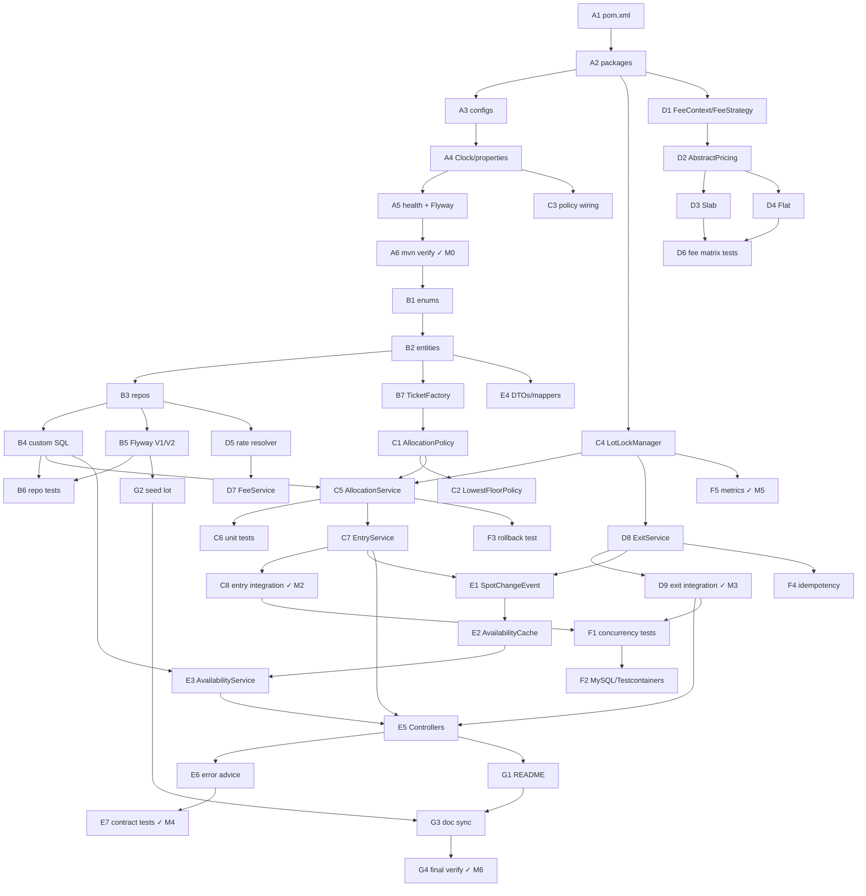
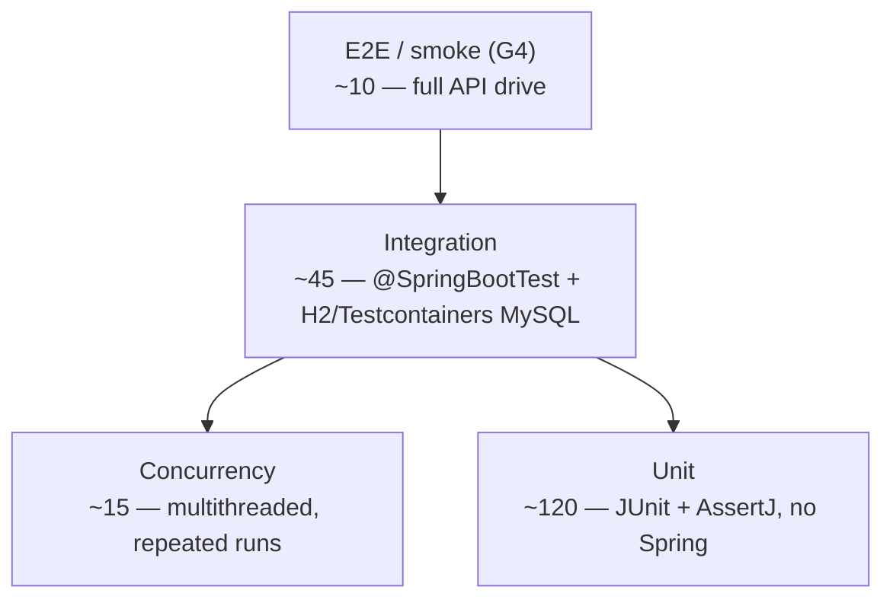

# Planning — Smart Parking Lot System (LLD → Working System)

> Implementation plan to build the system described in [`architecture.md`](architecture.md).
> Stack: **Java 8 · Spring Boot 2.7.x · MySQL 8 · Maven**.
> Process: 6 sections (this file), 7 milestone phases (M0–M6), 46 tasks (A1…G4).

### ✅ Status — build complete

All 46 tasks are implemented. `mvn verify` is green: **111 tests pass**, plus `F2MySqlConcurrencyIT`
which registers as *skipped* on this machine (no Docker — see RK1).

| Milestone | State | Evidence |
|---|---|---|
| **M0** Skeleton | ✅ | App boots, `GET /health` → 200 `{"status":"UP"}` |
| **M1** Domain & schema | ✅ | Flyway `V1`+`V2`+`V3`; `RepositoryQueriesTest` (8) |
| **M2** Allocation | ✅ | `AllocationPolicyTest` (10), `EntryFlowIntegrationTest` (10) |
| **M3** Exit & fees | ✅ | `PricingStrategiesTest` (33) reproduces all 7 worked examples; `ExitFlowIntegrationTest` (9) |
| **M4** Availability & API | ✅ | `ApiContractTest` (16), `AvailabilityIntegrationTest` (9) |
| **M5** Concurrency | ✅ | `LotLockManagerTest` (6), `ParkingConcurrencyTest` (5 scenarios) |
| **M6** Ops & docs | ✅ | `README.md`, actuator `/health` `/metrics` `/info`, `architecture.md` §6 resolutions |

**Deviations from this plan** (all recorded in `architecture.md` §6 *"Implementation resolutions"*
and in the code):

1. **Datasource** — no Docker/MySQL on the build machine, so H2 in MySQL compatibility mode is the
   default local runtime and MySQL is the `mysql` profile. Flyway owns the schema either way.
   RK1 stays open until F2 runs somewhere with Docker.
2. **Fee arithmetic** — three spec inconsistencies (SLAB block model, BUS ⇒ `FLAT`, cap applied as a
   session ceiling) were resolved in favour of the §6 worked-example table, which is what TC-3 asserts.
3. **Lock release** — locks are released in `TransactionSynchronization.afterCompletion`, i.e. *after*
   commit/rollback, not when the service method body ends; otherwise a second gate could read the
   still-uncommitted `FREE` status and double-book the spot.
4. **Ticket lock key** — striped on the *ticket number*, not the id, so the row is first read
   *inside* the lock. Reading it earlier pins a pre-commit snapshot and makes `@Version` trip instead
   of `409 TICKET_ALREADY_CLOSED`.
5. **Allocation tie-break** — the optional motorcycle→CAR relaxation never preempts a free
   motorcycle bay (exact-type match always wins first).
6. **Timestamps** — truncated to whole seconds at the service boundary, matching the `DATETIME`
   column; sub-second values were silently lost on reload and drifted `duration_minutes` by one.
7. **Task A5** — the Flyway *placeholder* was replaced directly by the real `V1__init.sql`.

---

## Table of contents

1. [Milestones & phases overview](#1-milestones--phases-overview)
2. [Work breakdown (task list per module)](#2-work-breakdown-task-list-per-module)
3. [Implementation order & dependencies](#3-implementation-order--dependencies)
4. [Testing strategy](#4-testing-strategy)
5. [Risks, assumptions & mitigations](#5-risks-assumptions--mitigations)
6. [Acceptance criteria / definition of done](#6-acceptance-criteria--definition-of-done)

---

## 1. Milestones & phases overview

### 🎯 Definition of Done (summary; full list in §6)

A reviewer can: start MySQL + `mvn spring-boot:run` → drive a full entry/exit on the API → see correct fee &
availability → run `mvn test` green (unit + concurrency + integration) → read `architecture.md` and map every
section to code.

### 🏁 Milestones

| M | Phase | Scope | Exit criteria |
|---|---|---|---|
| **M0** | **Skeleton** | Maven project, packages per architecture §2, Flyway `V1`, health endpoint, CI-friendly `mvn verify` | App boots, `/health` 200, empty test suite passes |
| **M1** | **Domain & schema** | Entities, enums, repos, `V1__init.sql`, seed `V2__seed_rates.sql`, `Clock` bean | CRUD-level repo tests green |
| **M2** | **Allocation** | `AllocationPolicy` + 2 impls, `AllocationService`, `LotLockManager`, check-in flow | Check-in assigns correct spot; full-lot → 409 |
| **M3** | **Exit & fees** | `FeeStrategy` + slab/flat, `FeeService`, `ExitService`, receipt | Fee tables from architecture §6 reproduced exactly |
| **M4** | **Availability & API** | `AvailabilityService` + cache + listener, all controllers, error advice, DTO/mappers | Full API contract (architecture §8) test-covered |
| **M5** | **Concurrency hardening** | `FOR UPDATE` queries, after-commit events, lock timeouts, the 5 concurrency tests | Tests 1–5 green under repeated runs |
| **M6** | **Ops & docs** | Metrics, structured logging, README run guide, doc sync | Fresh-clone → running in ≤ 10 min |

```mermaid
gantt
    title Parking Lot System — Milestones
    dateFormat  X
    axisFormat %s
    section Foundation
    M0 Skeleton            :m0, 0, 1
    M1 Domain & schema     :m1, after m0, 2
    section Core features
    M2 Allocation          :m2, after m1, 2
    M3 Exit & fees         :m3, after m2, 2
    section Surface
    M4 Availability & API  :m4, after m3, 2
    section Hardening
    M5 Concurrency         :m5, after m4, 2
    M6 Ops & docs          :m6, after m5, 1
```



### 📦 Deliverables checklist

- [x] `architecture.md` (9 approved sections)
- [x] `planning.md` (this file, 6 sections)
- [x] Spring Boot 2.7 / Java 8 codebase, package layout per architecture §2
- [x] MySQL schema via Flyway (`V1` schema, `V2` seed rates, `V3` seed lot)
- [x] REST API per architecture §8 contract
- [x] Test suites: unit (allocation, fee), concurrency (5 scenarios), integration (API contract)
- [x] README: setup, run, sample curl calls

---

## 2. Work breakdown (task list per module)

**Legend:** `[T#]` task id · **Est** = S / M / L (≈ 0.5 h / 2 h / 4 h+) · **Dep** = depends on · **Ref** = architecture reference

### 📁 Module A — Project skeleton *(M0)*

| Task | Desc | Est | Dep | Ref |
|---|---|---|---|---|
| A1 | Maven `pom.xml`: Spring Boot 2.7.x, Java 8, web/data-jpa/validation/flyway/mysql, actuator, test deps | S | — | arch §1 |
| A2 | Package layout: `web`, `service`, `strategy`, `model`, `repository`, `config`, `cache`, `lock` | S | A1 | arch §2 |
| A3 | `application.yml` + `application-test.yml` (H2 or Testcontainers MySQL), `parking.*` properties | S | A1 | D1 |
| A4 | `Clock` bean (`Clock.systemUTC()`), `@ConfigurationProperties` binder for `parking` | S | A2 | A4 |
| A5 | `GET /health` (actuator) + `V1__placeholder.sql` so Flyway runs | S | A3 | M0 |
| A6 | Verify: `mvn -q verify` green on empty suite | S | A1–A5 | M0 exit |

### 📁 Module B — Domain & persistence *(M1)*

| Task | Desc | Est | Dep | Ref |
|---|---|---|---|---|
| B1 | Enums: `VehicleType`, `SpotStatus`, `TicketStatus`, `PricingStrategyType` | S | A2 | arch §3 |
| B2 | Entities: `Vehicle`, `ParkingFloor`, `ParkingSpot`, `ParkingTicket` (`@Version`), `FeeRate` | L | B1 | arch §3 |
| B3 | Repos: `VehicleRepository`, `SpotRepository`, `TicketRepository`, `FeeRateRepository` + derived queries | M | B2 | arch §3 |
| B4 | Custom SQL: `findFreeByFloorAndType` (indexed, `ORDER BY position`), `findForUpdate`, `existsOpenTicketForVehicle`, availability `GROUP BY` | M | B3 | arch §5, §7 |
| B5 | Flyway: finalise `V1__init.sql` (arch §3 DDL), add `V2__seed_rates.sql` (arch §6 rate card) | M | B1 | N1–N6 |
| B6 | Repo integration tests: seed → query → assert (H2/Testcontainers) | M | B3–B5 | §4 |
| B7 | `TicketFactory`: ticket-no generation + rate snapshot at check-in | S | B2 | P3, N4 |

### 📁 Module C — Allocation *(M2)*

| Task | Desc | Est | Dep | Ref |
|---|---|---|---|---|
| C1 | `AllocationPolicy` interface + `NearestEntryPolicy` | S | B2 | P1, arch §5 |
| C2 | `LowestFloorPolicy` (multi-floor scan) | M | C1 | arch §5 |
| C3 | Config wiring: `parking.allocation-policy` → bean selection (`@Qualifier`) | S | A4, C1–C2 | D1 |
| C4 | `LotLockManager`: striped floor locks, per-ticket locks, `tryLock(2s)` → `GATE_BUSY` | M | A2 | arch §7 |
| C5 | `AllocationService`: candidate query → policy pick → occupy + ticket (txn) | L | B4, C1, C4 | arch §5 |
| C6 | Unit tests: compatibility matrix (M/C/B × spot), position ordering, empty list | M | C1 | arch §5 |
| C7 | `EntryService.checkIn`: already-parked check, vehicle upsert, normalise plate, publish event | L | B7, C5 | arch §5 |
| C8 | Integration: check-in happy path + `PARKING_FULL` + `ALREADY_PARKED` | M | C7 | arch §8 |

### 📁 Module D — Fees & exit *(M3)*

| Task | Desc | Est | Dep | Ref |
|---|---|---|---|---|
| D1 | `FeeContext` (Builder) + `FeeStrategy` interface | S | A2 | P6, arch §4 |
| D2 | `AbstractPricingStrategy`: `ceilDiv`, grace, cap×days, `HALF_UP` 2dp | M | D1 | R1–R4, R7 |
| D3 | `SlabPricingStrategy` | S | D2 | arch §6 |
| D4 | `FlatPricingStrategy` | S | D2 | arch §6 |
| D5 | Rate resolver: active `FeeRate` for type @ check-in; missing ⇒ `RATE_NOT_CONFIGURED` | M | B3 | R6, N3 |
| D6 | **Table-driven unit tests** — the arch §6 worked-example matrix as fixtures (all 7 rows + boundaries) | L | D3–D4 | arch §6 |
| D7 | `FeeService.calculate(ticket)` + `quote(request)` | M | D5 | arch §8 #7 |
| D8 | `ExitService.checkOut`: `FOR UPDATE` → validate → fee → close + free spot (txn) | L | D7, C4, B4 | arch §7 |
| D9 | Integration: full entry→exit, receipt fields, `TICKET_ALREADY_CLOSED`, `INVALID_EXIT_TIME` | M | D8 | C8 |

### 📁 Module E — Availability & API surface *(M4)*

| Task | Desc | Est | Dep | Ref |
|---|---|---|---|---|
| E1 | `SpotChangeEvent` + `@TransactionalEventListener(AFTER_COMMIT)` | M | C7, D8 | P4 |
| E2 | `AvailabilityCache` with `lotVersion` keys + DB fallback | M | E1 | D4 |
| E3 | `AvailabilityService.current()` → per-floor free/total by type | M | B4, E2 | arch §8 #3 |
| E4 | DTOs + mappers for all endpoints (entities never leave service) | M | B2 | P7 |
| E5 | Controllers: `EntryGateController`, `ExitGateController`, `AvailabilityController`, `TicketController` | L | E3, E4, C7, D8 | arch §8 |
| E6 | `@RestControllerAdvice`: uniform problem+json, `code` enum mapping | M | E5 | C1–C2 |
| E7 | Contract tests per endpoint incl. every error code from the arch §8 table | L | E6 | C1–C8 |

### 📁 Module F — Concurrency hardening *(M5)*

| Task | Desc | Est | Dep | Ref |
|---|---|---|---|---|
| F1 | Tests 1–5 from arch §7 (`ExecutorService`, latches, repeated runs) | L | C8, D9 | arch §7 |
| F2 | Verify isolation/lock behaviour on real MySQL (Testcontainers), not just H2 | M | F1 | arch §7 |
| F3 | Rollback test: forced failure after occupy ⇒ spot `FREE` again | M | C5 | arch §7 |
| F4 | Idempotent exit replay (`?replay=true`) + duplicate check-in | M | D8 | C3 |
| F5 | Metrics: `parking.lock.wait`, `parking.entry.duration`, allocation failures | M | C4, E1 | arch §9 |

### 📁 Module G — Ops & documentation *(M6)*

| Task | Desc | Est | Dep | Ref |
|---|---|---|---|---|
| G1 | README: prerequisites, MySQL setup, `mvn spring-boot:run`, sample curl for all endpoints | M | E5 | M6 |
| G2 | Seed script for demo lot (floors + spots) `V3__seed_lot.sql` | M | B5 | — |
| G3 | Sync `architecture.md` ↔ code (package names, config keys) | M | all | traceability |
| G4 | Final `mvn verify` + smoke script hitting the API end-to-end | M | G1–G3 | M6 exit |

### 📊 Roll-up

| Module | Tasks | S | M | L | Est. total |
|---|---|---|---|---|---|
| A Skeleton | 6 | 6 | 0 | 0 | ~0.5 d |
| B Domain | 7 | 1 | 5 | 1 | ~1.5 d |
| C Allocation | 8 | 3 | 4 | 1 | ~2 d |
| D Fees & exit | 9 | 3 | 5 | 1 | ~2 d |
| E Availability/API | 7 | 0 | 6 | 1 | ~2 d |
| F Concurrency | 5 | 0 | 4 | 1 | ~1 d |
| G Ops/docs | 4 | 0 | 4 | 0 | ~0.5 d |
| **Total** | **46** | **13** | **28** | **5** | **≈ 9.5 dev-days** |

---

## 3. Implementation order & dependencies

### 🔀 Execution sequence



### 🛤️ Critical path

`A1 → A2 → A4 → A6 → B1 → B2 → B3 → B4 → C5 → C7 → C8 → F1 → F2 → … → G4`

**≈ 9.5 dev-days** total; critical path drives ~7 d.

Parallelisable after M1:
- **Lane 1:** Module C (allocation) while **Lane 2:** Module D (fees) — both start after B7, only share B4/B7.
- Module E waits for C7 + D8 (both use-cases exist).

### 🔒 Layer-by-layer rule

1. Interfaces & enums first (`AllocationPolicy`, `FeeStrategy`, `FeeContext`) — signatures stable early.
2. Then pure strategies (unit-testable without Spring/DB).
3. Then repositories + schema (integration testable).
4. Then services (`@Transactional`, locks) — composition of 1–3.
5. Then controllers/DTOs (thin) — last, since they only delegate.
6. Then concurrency tests + metrics — they exercise everything above.

### 🚫 Do-not-break rules

- Don't write a controller before its service method exists (compile-safe ordering).
- Don't add a repo query before its table exists (Flyway before B3 queries).
- Don't enable lock manager before the txn boundary exists (C4 before C5).
- Schema changes only via Flyway — never `ddl-auto=update`.

---

## 4. Testing strategy

### 🎯 Test pyramid



### 📋 Suite map

| Layer | Scope | Tooling | Key cases (refs) |
|---|---|---|---|
| **Unit — allocation** | `NearestEntryPolicy`, `LowestFloorPolicy`, `isCompatible` | JUnit, plain POJOs (D3) | Type matrix M/C/B × spots, `ORDER BY position`, empty list → `Optional.empty`, motorcycles-on-car flag on/off (C6) |
| **Unit — fees** | `Slab`, `Flat`, `AbstractPricing` | Table-driven tests = **arch §6 worked-example matrix verbatim** | Grace boundary (14/15/16 min), exact block edge (30/31, 120/121 min), cap, multi-day `cap×days`, 0-stay, 1 ms stay, `HALF_UP` 2dp, `BigDecimal` only (D6) |
| **Unit — lock manager** | `LotLockManager` | Concurrent test, mocked `Supplier` | Stripes isolate floors, timeout → `GATE_BUSY`, unlock on exception, interrupt handling (C4) |
| **Unit — factory/mapper** | `TicketFactory`, DTO mappers | AssertJ | Ticket-no uniqueness format, rate snapshot frozen (N4, B7) |
| **Repo integration** | Custom SQL | `@DataJpaTest` + H2/Testcontainers | `findFreeByFloorAndType` order + index usage, `FOR UPDATE` blocks, `existsOpenTicketForVehicle`, availability `GROUP BY` (B6, F2) |
| **API contract** | All 8 endpoints + **every error code** in arch §8 table | `@SpringBootTest` + `MockMvc`/`TestRestTemplate` | Status codes, problem+json shape, `code` stability, validation errors, plate normalisation, replay exit (C1–C8, E7) |
| **Concurrency** | 5 scenarios from arch §7 | `ExecutorService` + latches, `@RepeatedTest(20)` | ① 100 threads / 10 spots ⇒ exactly 10 win ② double check-in ⇒ 1 ticket ③ double check-out ⇒ 1 receipt ④ entry/exit race ⇒ availability correct ⑤ forced rollback ⇒ spot `FREE` (F1, F3) |
| **Idempotency** | Retry semantics | Integration | Duplicate entry `409`, `?replay=true` returns original receipt (F4) |
| **Failure-path** | DB down / lock timeout | Testcontainers + fault injection | Circuit opens → 503, no orphan rows (arch §9) |

### 🧪 Quality gates

- `mvn verify` = compile + unit + integration; **any red blocks merge**.
- Concurrency suite runs **20 repetitions** (flakes are signal, not noise).
- Coverage target: **strategies ≥ 90 %**, services ≥ 80 %, controllers via contract tests
  (line coverage is a proxy, not the goal).
- Determinism: injectable `Clock` fixed in tests; no `Thread.sleep` for synchronization — use
  `CountDownLatch` / Awaitility.

---

## 5. Risks, assumptions & mitigations

| # | Risk / open question | Impact | Likelihood | Mitigation |
|---|---|---|---|---|
| RK1 | **H2 ≠ MySQL** for `FOR UPDATE`, gap locks | High — concurrency tests pass falsely | Med | Run F2 suite on **Testcontainers MySQL 8**; H2 only for fast unit-level repo checks |
| RK2 | **Partial unique "one open ticket per spot"** not native in MySQL (N1) | Med — relies on app locks | Med | Enforce via floor/ticket lock (Layer 2) + `spot_id+status` query check; revisit with generated-column unique index if multi-node |
| RK3 | **Single-JVM lock assumption breaks on scale-out** (2 nodes) | High if scaled | Low (v1 single node) | Layer 3 DB row locks already tie-break (arch §7); lock manager interface designed to swap → ShedLock/DB advisory locks |
| RK4 | **Enum vs reference table** for `vehicle_type` (E1) | Med — refactor cost later | Med | Decision: keep `VARCHAR + CHECK` in v1; migrate to `vehicle_type` table only if types become admin-managed |
| RK5 | **Bus = 3 adjacent CAR spots** undefined | Med — utilisation | Med | v1 dedicated BUS spots (A2); `CompositeAllocationPolicy` extension point reserved (arch §9) |
| RK6 | **Rate-card model too rigid** (surge/hourly matrices) | Med | Low | `fee_rate.strategy` + `valid_from` extensible; flat/slab cover stated requirements |
| RK7 | Clock skew between gates (A4) | Med — wrong fee | Low | Server-side `Clock` only; client `exitTime` optional & validated `≥ entry` (R5) |
| RK8 | Availability endpoint on hot `COUNT(*)` | Med at scale | Med | `AvailabilityCache` + `lotVersion`; if still hot, materialised counter rebuilt by event (kept as fallback, not source of truth) |
| RK9 | Lock contention on one popular floor | Med — `GATE_BUSY` spikes | Med | Stripes + 2 s timeout + metric `parking.lock.wait` alerting; optional: sub-floor lock by spot position range |
| RK10 | `requriment.txt` truncated ("Deliverables" cut off) | Low | High | Deliverables inferred as LLD doc + design + tests (listed in §1); **confirm with stakeholder** |
| RK11 | Scope creep (payments, reservations, sensors) | Med — schedule | Med | Explicitly out of scope (arch §1); extension points documented instead of built |
| RK12 | Java 8 constrains language (no `var`, records, `List.of`) | Low | High | Accepted — Spring Boot 2.7.x pinned; design avoids Java 9+ APIs in snippets |

**Assumptions carried from architecture §1, §5, §6 (A1–A7, R1–R8)** are re-validated at M0 review;
any change ⇒ impact review on architecture Steps 3/5/6.

---

## 6. Acceptance criteria / definition of done

### ✅ Functional acceptance (maps to `requriment.txt` Functional Requirements)

| Requirement | Acceptance test | Pass criterion |
|---|---|---|
| Spot allocation by vehicle size | TC-1: send MOTORCYCLE/CAR/BUS entries | Each gets a spot of matching `spot_type`; never a wrong-type spot |
| Check-in / check-out timestamps | TC-2: entry & exit round-trip | `entryTime`/`exitTime` persisted ISO-8601 UTC, exactly one OPEN ticket per parked vehicle |
| Fee by duration + vehicle type | TC-3: arch §6 matrix replayed via API | All 7 worked examples return the documented amounts, `HALF_UP` 2dp |
| Real-time availability | TC-4: entry then `GET /availability` | Free count for that floor/type drops immediately; exit restores it; totals never drift after 1000 mixed ops |
| DB schema (spots / vehicles / transactions) | TC-5: Flyway `V1`/`V2` on clean MySQL | Schema matches arch §3 DDL; seeds produce the arch §6 rate card |
| Allocation algorithm | TC-6: unit suite C6 | Nearest-entry picks lowest `position`; empty candidates → `PARKING_FULL` |
| Concurrency | TC-7: 5 arch §7 scenarios × 20 reps | Zero double-bookings, one ticket, one receipt, availability correct, rollback clean |

### 🧩 Design-quality acceptance

- [ ] Every `architecture.md` section maps to a package/class (**G3 traceability table** in README)
- [ ] Every error code in arch §8's table has a contract test
- [ ] Domain + strategies have **zero Spring imports** (D3 — enforced by an ArchUnit or package-rule test)
- [ ] Strategies & policies swappable via `parking.*` properties only (D1 — test flips config, no code change)
- [ ] Money is `BigDecimal` end-to-end (R7 — grep test)
- [ ] No `ddl-auto=update`; schema changes only via Flyway

### 🚀 Operational acceptance (M6)

- [ ] Fresh clone → `docker compose up mysql` → `mvn spring-boot:run` → first successful entry in **≤ 10 min**
- [ ] `mvn verify` green from clean checkout
- [ ] Smoke script (G4) drives: 3 entries → availability → 3 exits → asserts fees
- [ ] Metrics emitted: `parking.lock.wait`, `parking.entry.duration`, allocation failures
- [ ] Error responses carry `code`, `timestamp`, `traceId`

### 📄 Documentation acceptance

- [ ] `architecture.md` = 9 approved sections, Mermaid diagrams render
- [ ] `planning.md` = 6 approved sections (this file)
- [ ] README: setup, config keys, endpoint list with sample curl, rate-card table, extension guide

### 🏁 Final sign-off

```
[ ] All 46 WBS tasks complete (A1…G4)
[ ] Quality gates green (unit ≥ 90% on strategies, concurrency ×20)
[ ] All 7 functional acceptance rows pass
[ ] Stakeholder confirms the truncated "Deliverables" list (RK10)
        → planning.md COMPLETE → ready to build
```
